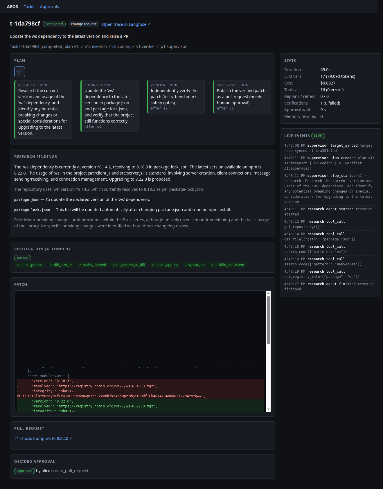
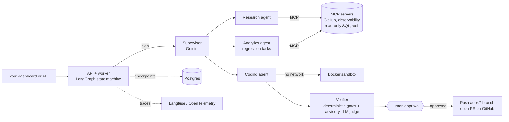

# AEOS: Autonomous Engineering OS

A multi-agent system that takes an engineering request in plain English, investigates it, makes
the change in an isolated sandbox, **verifies it independently**, **waits for a human to approve**,
and then opens a **real GitHub pull request**. Every step is traced, and a crashed worker resumes
from its last checkpoint.

> **Live proof:** asked through the dashboard, "update the ws dependency to the latest version
> and raise a PR", it produced
> [Shrihari-Nair/broadcast-server#1](https://github.com/Shrihari-Nair/broadcast-server/pull/1):
> `ws` 8.18.3 → 8.22.0 with a regenerated lockfile, 17 LLM calls, 79k tokens, about $0.03, 65 s.



## What it can do

| Task type | Works on | Example request |
|---|---|---|
| **Change request** | Your real GitHub repo (mirrored locally) | "Update the `ws` dependency and raise a PR" |
| **Latency regression** | A seeded demo service with fake logs, metrics and traces | "Find why checkout latency increased, fix it, and prepare a PR" |

Both types go through the same loop: **plan → investigate → change in sandbox → independent
verification → human approval → PR**. Merging is never done by the system.

## How it works



- **Agents decide, code enforces.** Models plan, choose tools and write the patch. The risk
  policy, sandbox limits, verifier gates, read-only SQL guard, retries and idempotency are plain
  code, not prompts.
- **Verification does not trust the agent.** The patch is re-applied to a fresh checkout and
  re-checked (change requests: diff safety, secrets, JS/Python/JSON syntax, `package.json` and
  lockfile agreement; regressions: tests, lint, benchmark against the last good commit). An LLM
  judge can only make a verdict stricter, never override a failed gate.
- **Approval is bound to what you saw.** The approval stores a hash of the exact PR arguments;
  a changed request no longer matches and is blocked.
- **Durable.** State is checkpointed to Postgres after every step. Workers hold leases; if one is
  killed (`kill -9`), another resumes without repeating side effects.
- **MCP vs A2A.** Agents reach tools through four MCP servers (23 tools, each with a declared
  risk level). Specialists can also run as separate services speaking the A2A protocol.

More detail: [docs/ARCHITECTURE.md](docs/ARCHITECTURE.md) (components, failure table, span schema),
[docs/DECISIONS.md](docs/DECISIONS.md) (45 design decisions with reasons),
[docs/INTERVIEW_PREP.md](docs/INTERVIEW_PREP.md) (plain-language walkthrough).

## Quick start

Requirements: Docker with Compose, a Gemini API key. (For real PRs, a GitHub token with
*Contents* and *Pull requests* read/write on one repo.)

```bash
python3 scripts/init_env.py      # creates .env with fresh local secrets (never overwrites)
# edit .env: set AEOS_GEMINI_API_KEY, and for real PRs AEOS_GITHUB_REPO=owner/name and AEOS_GITHUB_TOKEN
docker compose --profile observability up -d --build
```

Then open **http://localhost:3100**.

| URL | What |
|---|---|
| http://localhost:3100 | Dashboard: submit requests, watch agents live, approve or reject |
| http://localhost:8800 | REST API (`/tasks`, `/approvals`, `/tasks/{id}/events/stream`) |
| http://localhost:3000 | Langfuse: full trace per task (the dashboard links to it) |

1. Pick the target (your repo, or the demo service) and type a request.
2. Watch the plan, findings and tool calls appear. A task takes about a minute or two.
3. When it says *awaiting approval*, review the diff and gates and click **Approve** (or Reject
   with feedback, which triggers a re-plan).
4. For a change request, the PR link appears on the task page.

No API key? Set `AEOS_DASHBOARD_LLM=fake` and `AEOS_DASHBOARD_REPLAY=happy` in `.env` to replay a
scripted run of the demo scenario for free.

`.env` is git-ignored. `make secrets` (also run in CI) fails if a real key could be committed.

## Terminal (everything the dashboard does)

The same API drives a terminal client, so you can work without a browser (or alongside it).
`./scripts/aeos <command>` runs it inside the API container (no local Python needed).

```text
$ ./scripts/aeos chat
AEOS chat · api http://localhost:8000 · repo owner/name · target change · you are alice
aeos> update the ws dependency to the latest version and raise a PR
t-1a2b3c4d  (change)
10:02:11  supervisor  plan_created  plan v1: s1:research | s2:coding | v1:verifier | p1:supervisor
...
APPROVAL ap-... [pending]   (gates, benchmark, files)
[a]pprove  [r]eject  [d]iff  [f]indings  [s]kip > a
approved as alice; the task resumes on the worker
pull request: https://github.com/owner/name/pull/2
```

| Dashboard | Terminal |
|---|---|
| Tasks list, new task, target | `aeos tasks [--watch]`, `aeos new "goal" --kind change\|regression [--watch]`, `/target` in chat |
| Task page: plan, steps, findings, root cause, verification, diff, PR, stats | `aeos show <id> [--plan\|--step s1\|--findings\|--root-cause\|--verify\|--diff\|--stats] [--json]` |
| Live timeline | `aeos watch <id>`, `aeos events <id> --follow` |
| Approve / reject with feedback | prompt in `watch`/`chat`, or `aeos approve\|reject <approval-id> [--feedback ...]` |
| Approvals inbox | `aeos approvals` |
| Langfuse + PR links | `aeos open <id>` |

Inside `aeos chat` the same things are slash commands (`/tasks`, `/show`, `/watch`, `/approvals`,
`/approve`, `/reject`, `/stats`, `/diff`, `/open`, `/target`, `/actor`, `/help`). Ctrl+C while
watching detaches; the task keeps running. Agent output is stripped of terminal escape codes
before it is printed. Exit codes: 0 completed, 1 failed, 2 API unreachable, 3 waiting for approval.

## Safety model

| Layer | Rule |
|---|---|
| Sandbox | Docker, no network, read-only root fs, non-root, all capabilities dropped, memory/CPU/PID limits, command allowlist |
| Registry access | npm lookups and lockfile regeneration run in a separate throw-away container with fixed commands and `--ignore-scripts` |
| Database | Single `SELECT` only (sqlglot allowlist) on a read-only role with a statement timeout |
| Risk policy | `policy/risk_policy.yaml`: merge and force-push denied, writes only to `aeos/*` branches, PRs need approval, deny always wins |
| GitHub | Nothing is pushed before approval; no merge tool exists; pushes are never forced |
| Prompt injection | Tool output is labelled untrusted data; actions driven only by untrusted content need approval |
| Secrets | Redacted from traces and memory; rejected in diffs by a verifier gate |

## Results and tests

- About **530 tests** (506 default, 27 chaos tests with real process kills), plus lint and type checks.
- **Eval harness:** 30 tasks (6 bug types × 5 variants) with deterministic and rubric graders.
  The LLM judge agrees with human labels at Spearman 0.80 (100% pass/fail agreement). With a
  deliberately broken retry policy the scripted suite's success rate falls from 100% to 0%,
  so the evals do detect regressions.
- **Live Gemini result:** the one recorded full run solved **15 of 30** tasks (50%). Later fixes
  (blame lookup, baseline selection, stronger planning model) improved it in a follow-up run that
  was not saved, so no newer number is claimed here.

## Project layout

```
src/aeos/
  agents/      supervisor, specialists, agent loop, verifier(s), LLM judge
  graph/       LangGraph nodes, routing, publish + approval flow
  mcp_servers/ github, observability, database, web (+ real-GitHub PR mirroring)
  sandbox/     Docker sandbox, npm registry container, command policy
  a2a/         agent-to-agent services and client
  api/         FastAPI app (tasks, approvals, SSE events)
  store/       tasks queue with leases, approvals, event log
  memory/      episodic and semantic memory with a write gate
  telemetry/   OpenTelemetry tracing and metrics
web/           Next.js 15 dashboard
demo_target/   seeded demo service, data generator, ground truth
evals/         dataset, graders, judge validation, results
policy/        risk_policy.yaml
tests/         unit, integration, graph end-to-end, chaos
```

## Tech stack

Python 3.12, LangGraph, Gemini (`google-genai`), MCP, A2A, FastAPI, Pydantic v2, PostgreSQL 16 +
pgvector, psycopg, sqlglot, Docker, OpenTelemetry, Langfuse, Next.js 15, React 19, TypeScript,
GitHub REST API, pytest, ruff, mypy, uv, GitHub Actions.

## Known limitations

- Repos without a test suite (like the demo target repo, `broadcast-server`) can only be checked
  for syntax, diff safety and lockfile consistency; the PR body says so. Review before merging.
- Change requests run in single-process mode (not over A2A) and use Node/Python syntax checks only.
- The test suite shares the dev database: **do not run `make test` while using the dashboard**;
  some tests clear the task queue.
- Memory is implemented, but a small comparison (3 runs per arm) showed no measurable benefit.
- A prototype, not a production service: single worker, no authentication on the dashboard
  (the "acting as" name is typed in).

## Development

```bash
uv sync
make check        # lint, mypy, secret scan, tests (needs Postgres + Docker running)
```
